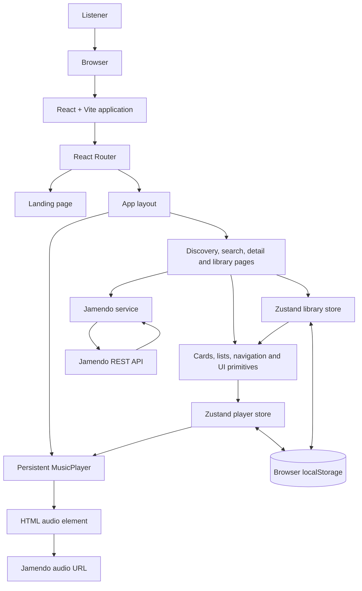
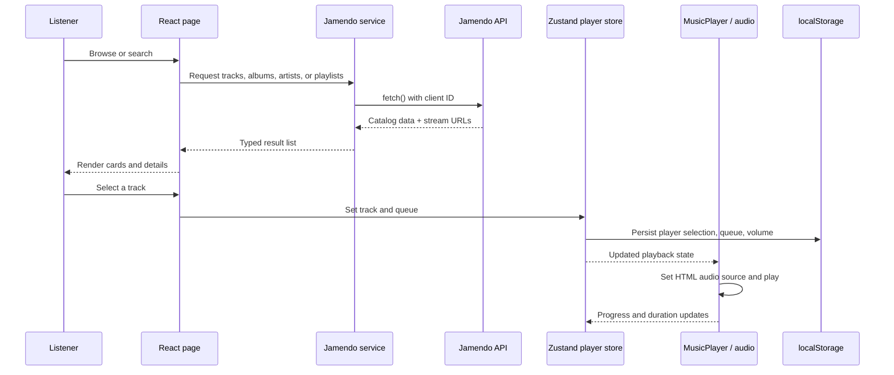

# Tunes

Tunes is a responsive, browser-based music discovery and playback app. It lets listeners explore popular tracks, artists, albums, genres, and playlists from the Jamendo catalog; search for music; play preview audio; and keep a personal library of liked tracks, saved albums, and followed artists.

It is a frontend-only application. Catalog data and audio URLs come directly from the Jamendo API, while personal playback and library preferences stay in the browser.

## Features

- Discover popular tracks, artists, albums, playlists, new releases, and genre collections.
- Search tracks with a debounced, live Jamendo search.
- Open artist, album, genre, and playlist detail pages.
- Play audio with a persistent bottom player, queue navigation, seeking, and volume control.
- Like tracks, save albums, and follow artists.
- Persist the player queue, volume, and library in `localStorage` across browser sessions.
- Use the experience across desktop and mobile layouts, with motion that respects reduced-motion preferences.

## Tech stack

| Area | Technology |
| --- | --- |
| UI | React 19, TypeScript |
| Build tooling | Vite 8, `@vitejs/plugin-react` |
| Styling | Tailwind CSS 4, shadcn-style UI primitives, Radix UI |
| Routing | React Router DOM 7 |
| Client state | Zustand with the persist middleware |
| Animation | Framer Motion |
| Icons | Lucide React and React Icons |
| Music catalog & streams | Jamendo REST API |
| Audio playback | Native HTML `<audio>` element |

## Architecture

Tunes is a single-page application. React Router selects the page, reusable UI components render it inside the shared layout, and pages obtain catalog data through one Jamendo service module. Zustand owns cross-page playback and library state; its persistence middleware writes the selected parts of that state to browser storage.



### Runtime data flow



### Source layout

```text
src/
├── components/
│   ├── layout/        # App shell, sidebar, top bar, mobile navigation
│   ├── player/        # Persistent audio player
│   └── ui/            # Reusable UI primitives
├── pages/             # Route-level screens
├── services/
│   └── jamendo.ts     # Typed Jamendo API client
├── stores/            # Persisted player and library state
├── App.tsx            # Route definitions and player mount point
└── main.tsx           # React and BrowserRouter bootstrap
```

## Getting started

### Prerequisites

- Node.js 20 or later
- A Jamendo API client ID

### Install and run

1. Install dependencies:

   ```bash
   npm install
   ```

2. Create a `.env` file from the example and provide your Jamendo client ID:

   ```env
   VITE_JAMENDO_CLIENT_ID=your_client_id
   ```

3. Start the development server:

   ```bash
   npm run dev
   ```

4. Open the local URL printed by Vite.

## Available scripts

| Command | Description |
| --- | --- |
| `npm run dev` | Start the Vite development server. |
| `npm run build` | Type-check the project and create a production build in `dist/`. |
| `npm run preview` | Serve the production build locally. |
| `npm run lint` | Run ESLint across the project. |

## Configuration and data ownership

`VITE_JAMENDO_CLIENT_ID` is compiled into the browser bundle, as is standard for a client-side Jamendo integration. Do not use it for secrets that require server-side protection.

Tunes does not currently include its own backend, authentication, database, or cloud synchronization. Liked songs, saved albums, followed artists, queue, and volume are stored per browser in `localStorage`; clearing site data removes them. Music metadata and playback sources are supplied by Jamendo and depend on that service being available.

## License and attribution

Music discovery and streaming data are provided by [Jamendo](https://www.jamendo.com/). Track availability and licensing are governed by Jamendo and the relevant artists.
